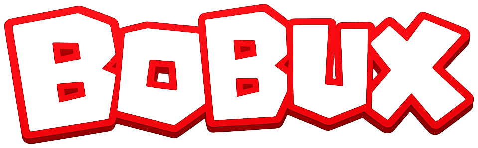

<p align="center">
  
</p>

# Bobux

**Игры, друзья и собственные миры в духе классических блочных платформ.**

Bobux — многопользовательская игровая платформа на Godot 4 для ПК и Android. В одном проекте находятся клиент, редактор миров, настройка аватара, каталог предметов, Luau runtime и серверная часть. Отдельный проект лаунчера отвечает за установку и обновления.

*Bobux is a Godot 4 multiplayer platform with a world editor, customizable avatars, a Luau scripting runtime and a dedicated server. Roblox API compatibility is an ongoing, explicitly measured effort.*

[Начать разработку](docs/DEVELOPMENT.md) · [Участие](CONTRIBUTING.md) · [Архитектура персонажа](docs/ROBLOX_CHARACTER_ARCHITECTURE_RU.md) · [Статус совместимости](docs/ROBLOX_CHARACTER_PARITY_RU.md) · [Сообщить об ошибке](https://github.com/Pavelord/bobux-platform/issues)

## Что внутри

- Лобби с режимами, профилями, друзьями и каталогом.
- Аватары с одеждой, аксессуарами и сохранёнными образами.
- Редактор миров и импорт `.rbxl` / `.rbxlx` через промежуточное представление.
- Luau-скриптинг с адаптацией сервисов, instances, событий и игровых API.
- Выделенные игровые комнаты, репликация и HTTP API для аккаунтов и публикаций.
- Отдельный лаунчер и экспортные настройки Windows, Android и Linux.

Проект активно развивается. Наличие API или импортированного класса не означает полного совпадения поведения с Roblox. Проверенные сценарии, известные расхождения и незавершённые этапы перечислены в [отчёте о совместимости](docs/ROBLOX_CHARACTER_PARITY_RU.md). Измерения в Studio и локальные проверки Bobux учитываются отдельно.

## Устройство проекта

| Каталог | Назначение |
| --- | --- |
| [`scenes/`](scenes), [`scripts/`](scripts) | Клиент, интерфейс, персонаж и редактор миров |
| [`autoload/`](autoload) | Сессия, сеть, загрузка контента, Luau engine и общие сервисы |
| [`addons/rbxl_importer/`](addons/rbxl_importer) | Конвертер формата миров и Godot importer |
| [`addons/roblox_runtime/`](addons/roblox_runtime) | Компоненты слоя совместимости |
| [`native/luau_bridge/`](native/luau_bridge) | Исходники нативного Luau GDExtension |
| [`services/bobux_api/`](services/bobux_api) | Node.js / Express API; PocketBase и локальные хранилища |
| [`server/`](server) | Выделенный Godot WebSocket-сервер и инструменты контента |
| [`launcher/`](launcher) | Самостоятельный Godot-проект лаунчера |
| [`tools/`](tools), [`tests/`](tests) | Проверки, измерительные стенды и зафиксированные результаты |
| [`docs/`](docs) | Архитектура, ограничения и технические отчёты |

Godot отвечает за клиент и игровые комнаты. Клиент обращается к HTTP API через `CloudAPI`, а к игровым комнатам — через сетевой слой. API обслуживает аккаунты, социальные функции и опубликованный контент. Названия `LuaScriptEngine` и `luaAPI` сохранены для интеграции; основной нативный runtime использует **Luau**.

## Быстрый старт для разработчика

Рабочая конфигурация проекта — **Godot 4.7**, рендерер Compatibility и нативный Luau bridge. Для крупных моделей и миров используется Git LFS.

```powershell
git lfs install
git clone https://github.com/Pavelord/bobux-platform.git
Set-Location bobux-platform
git lfs pull
```

Откройте `project.godot` в Godot 4.7 и дождитесь импорта ресурсов. Главная сцена — `scenes/login/login.tscn`; **F6** запускает выбранную сцену, **F5** — приложение. Для независимого запуска лаунчера откройте `launcher/project.godot`.

Сетевые функции требуют настроенного API и игрового сервера. В репозитории есть адреса действующего сервиса; для изолированной разработки настройте собственные endpoints. Локальные ключи, база игроков и приватный контент не входят в исходный код. Требования к зависимостям, проверки и команды экспорта описаны в [DEVELOPMENT.md](docs/DEVELOPMENT.md).

## Совместимость и качество

Текущая работа над персонажем идёт по поэтапному плану: defaults и API, физика, лазание, R15, вода и сиденья, lifecycle, анимации, камера и ввод, оформление, NPC. Общий статус — **в работе**, а не полная Roblox-совместимость. Экспериментальный профиль EnumItem включается отдельно; legacy-поведение остаётся необходимым для существующих миров.

Проверки выполняются по затронутой области: Godot validators, API tests, анализ импорта, сетевые сценарии и тесты на реальном Android. Количество локальных PASS не является гарантией производительности для всех устройств или всех режимов.

- [План архитектуры персонажа](docs/ROBLOX_CHARACTER_ARCHITECTURE_RU.md)
- [Текущие доказательства и незакрытые этапы](docs/ROBLOX_CHARACTER_PARITY_RU.md)
- [Измерительные инструменты](tools/character_parity/README.md)
- [Native-эксперименты в Roblox Studio](tools/roblox_character_experiments/README_RU.md)

## Исходники и сторонние материалы

В корне репозитория пока нет общей лицензии на код Bobux. Публичная доступность исходников сама по себе не задаёт разрешение на их переиспользование или распространение. Сторонние компоненты сохраняют собственные условия: [Godot LuaAPI](addons/luaAPI/LICENSE), [Luau bridge](native/luau_bridge/LICENSE), [иконки Lucide](assets/studio/icons/lucide/LICENSE), [шрифт Cascadia](assets/fonts/CASCADIA-LICENSE.txt).

Модели, музыка, текстуры, брендинг и пользовательские миры могут иметь отдельные права. Не следует считать весь контент свободным только потому, что рядом опубликован код. Bobux — самостоятельный проект, не официальный продукт Roblox Corporation.
